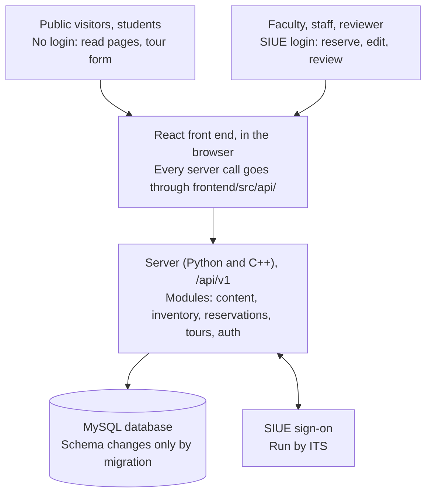

# Architecture

The browser reaches the database only through the API (QA plan 9.2).

## Modules

| Module | Holds | Path |
| --- | --- | --- |
| content | Announcements, Meet the Team, collaboration and research, photos and media | `backend/app/content/` |
| inventory | Plants that staff add and remove | `backend/app/inventory/` |
| reservations | Reservable spaces (editable) and faculty reservation requests | `backend/app/reservations/` |
| tours | Public tour requests (no login) | `backend/app/tours/` |
| auth | SIUE sign-on, roles, route allow-list | `backend/app/auth/` |

Rules: a module reaches another only through its service functions, never through its tables.
The front end reaches the server only through `/api/v1`, described in
[api/openapi.yaml](api/openapi.yaml).

## Open decisions

| ID | Decision | ADR |
| --- | --- | --- |
| D1 | Python web framework, and which server parts are C++ | [0001](decisions/0001-web-framework-and-cpp-split.md) |
| D2 | Hosting, test server, backups | [0002](decisions/0002-hosting-and-deploy.md) |
| D3 | SIUE sign-on protocol and test accounts | [0003](decisions/0003-siue-sign-on.md) |
