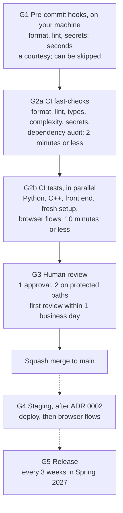
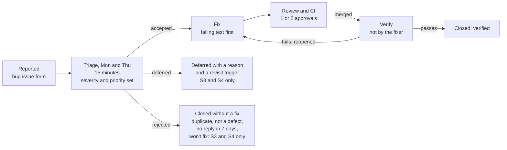
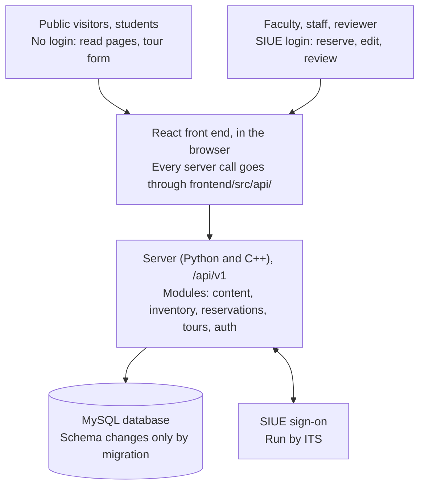

# Code Quality Assurance Plan: SIUE Greenhouse Website

Oct 23, 2026 · @Sam Wheeler

This plan sets the rules, checks, owners and records that keep the SIUE Greenhouse Website correct, accessible, maintainable and secure after our team hands it off at the end of Spring 2027. A new team or the Biology department webmaster should be able to run the project from this plan and the repository alone. Every file this plan names exists in the starter repository unless the plan says it is future work, and every number in it is something a tool or a named person reports.

| Item | Detail |
| --- | --- |
| Course | CS 425 Senior Project, Fall 2026, instructor William Grim |
| Team | Samuel Wheeler, Dane Niblett, Matthew Wilson, Yahir Romero |
| Sponsor | Jordyn Grawe, Biology Laboratory Manager (jgrawe@siue.edu) |
| Interim sponsor contact | Dr. Jason Williams, Chair of Biological Sciences (jasowil@siue.edu), while Jordyn is away this semester |
| Plan version | 1.0, submitted October 23, 2026. To be presented to Dr. Williams at the sponsor meeting on Tuesday, October 27, 2026; his feedback goes into version 1.1, with notes in docs/meetings/ |
| Where the plan lives | docs/QA\_PLAN.md in the project repository; changes follow Section 10.2 |

## 1. Introduction

### 1.1 Project and system context

The SIUE Greenhouse has no website today, so students, faculty and visitors have no central place to learn what it offers, and faculty have no online way to request space. Our team is building that site for the Department of Biological Sciences. It reflects the greenhouse as renovated (renovation ends November 2026), runs on an SIUE domain, and is linked from the Biology department page on siue.edu.

| User | Login | What they do on the site |
| --- | --- | --- |
| Students and public visitors | None | Read home, hours and location, plant information, Meet the Team, announcements, collaboration and research, photos and media; submit a tour request |
| Faculty | SIUE account | See which table spaces and times are open; submit a reservation request (amount of space, which space, time, plants, required conditions) |
| Greenhouse staff and graduate students | SIUE account | Add and remove plants in the inventory; post announcements |
| Reservation reviewer (Jordyn Grawe; Dr. Williams while she is away) | SIUE account | Approve or decline reservations; view tour requests; edit the list of reservable spaces |

The planned system has three parts: a React front end in the browser, a server that exposes a REST API under /api/v1, and a MySQL database (diagram in 9.2). SIUE single sign-on handles every login, and SIUE ITS owns the domain, hosting and sign-on service. Three choices are still open and tracked in Appendix C: the Python web framework, the hosting environment and the sign-on protocol. ITS answers decide the last two, and Dane owns that contact.

**Where C++ fits (proposal for ADR 0001).** Our project plan names C++, Python and MySQL. We propose that C++ does one bounded job: the reservation availability and conflict check, which decides whether a requested space and time overlaps an approved reservation. It is pure logic with no web or database code, so it is easy to test on its own with GoogleTest, and it is called from Python. Python does everything else. If ITS does not allow C++ on its servers, or the Python binding costs more than one week of work, the check is written in Python and the cpp/ folder is removed (fallback). Dane owns this decision (D1).

### 1.2 Purpose

This plan defines what "good enough" means for this site, which machine or person checks it, and what happens when a check fails. It has two readers: our team during Fall 2026 and Spring 2027, and whoever maintains the site after handoff.

It covers both halves of quality assurance. **Verification** asks whether we built the site right: lint, tests, review and the CI gates in Section 4. **Validation** asks whether we built the right site: sponsor acceptance at each release and the Spring 2027 usability study (3.3).

**Standard and tailoring.** The plan follows IEEE 730-2014, Standard for Software Quality Assurance Processes, the edition this course uses; IEEE 730-2026 has since superseded it. IEEE 730 is written for organizations with a separate QA group, so we kept its core activities (product assurance through reviews, tests and measurement; process assurance through gates, records and improvement) and cut these, on purpose:

| IEEE 730 activity we cut | Why it does not apply here | What covers the need instead |
| --- | --- | --- |
| Supplier and subcontractor control | We have no suppliers or subcontractors. Our only outside code is open-source packages. | Pinned lockfiles, Dependabot and dependency audits (6.1, M15) |
| Media control | Nothing is delivered on physical media. | Git, GitHub Releases and tagged versions (6.2) |
| A formal training program with training records | Four students; no budget or staff for one | The onboarding checklist (Appendix B) and SIUE's required accessibility training (9.6) |
| An organizationally independent QA group | The QA lead is also a developer | Independence by rule: nobody approves their own PR or verifies their own fix (3.4, 8.3) |
| Separate change-history records for each work product | They would duplicate what Git already keeps | Git history, PRs and Appendix D for this plan |

### 1.3 Scope

**In scope:** all code in the project repository (front end, API, database schema and migrations, the C++ library, tests, CI configuration and deploy scripts), the docs/ folder, seed and test data, and the process for changing any of them.

**Deliberately out of scope:**

- SIUE servers, domain, network and single sign-on. ITS owns these; we test our integration with them, not the services themselves.
- Accuracy of page content (plant facts, research text, photos). Greenhouse staff own content; we check that it renders and is accessible, not that it is botanically right.
- Features the Problem Specification excludes: online sales or payments, public user accounts, a native mobile app, and greenhouse equipment such as climate sensors or watering controls.
- The renovation itself, and maintenance after handoff. This plan prepares the next maintainer; it does not commit our team to maintain the site afterward.

### 1.4 Definitions and acronyms

| Term | Meaning in this plan |
| --- | --- |
| ADR | Architecture Decision Record: a one-page Markdown file in docs/decisions/, including the options we rejected |
| Build cop | The team member who, for one week, keeps main green: opens a revert PR within 1 hour of a break and quarantines flaky tests (5.1) |
| CI | Continuous integration: GitHub Actions checks that run on every pull request |
| Debt register | docs/DEBT.md, the list of shortcuts we took on purpose, with their cost and when we pay them (11.4) |
| Defect | A confirmed difference between specified and actual behavior, filed as a GitHub issue labeled bug |
| Definition of Done | docs/DEFINITION\_OF\_DONE.md, the checklist every issue meets before it is closed (3.5) |
| DORA metrics | The five delivery measures from Google's DevOps Research and Assessment program (Section 7) |
| Escaped defect | A defect first found after a release reached production |
| Gate | An automated or human check a change must pass before it moves on (4.1) |
| main | The protected branch; always deployable |
| Mutation testing | A tool makes small changes to the code and reruns the tests; a change the tests do not catch (a survivor) shows a test gap |
| P1 to P3 | Defect priority: how soon we fix it (8.3) |
| PR | Pull request |
| Quarantine | Skipping a flaky test, with the flaky label and an issue link, so it stops blocking others while its owner fixes it |
| Regression test | A test added with a fix that fails before the fix and passes after it |
| Reviewer of the week | The team member who, for one week, picks up any PR still waiting for a first review (5.1) |
| S1 to S4 | Defect severity: how much damage it does (8.3) |
| Small, medium, large tests | Test sizes (3.3): one process with no network or database; one machine with a real database; a full browser against the running site |
| Sponsor | Jordyn Grawe; Dr. Williams acts for her while she is away |
| SSO | SIUE single sign-on |
| Staging / production | The test copy of the site / the live site on siue.edu |
| WCAG 2.1 AA | Web Content Accessibility Guidelines 2.1, Level AA, the level SIUE Policy 2D6 requires |

### 1.5 References

- IEEE 730-2014, Standard for Software Quality Assurance Processes (the course edition; superseded by IEEE 730-2026)
- ISO/IEC 25010:2023, product quality model; the characteristic names in Section 2 come from it
- IEEE 1016, software design descriptions; the model for docs/ARCHITECTURE.md
- ISO/IEC/IEEE 29119-3, test documentation; the model for release test summaries
- W3C WCAG 2.1, Level AA
- [SIUE Policy 2D6, Digital Accessibility](https://www.siue.edu/policies/table-of-contents/2d6.shtml), effective February 5, 2026
- SIUE branding guidelines, Marketing and Communications
- PEP 8 (Python style), Google C++ Style Guide, OWASP Application Security Verification Standard Level 1, Semantic Versioning 2.0.0, Keep a Changelog
- Google Engineering Practices, "How to do a code review" (the source of our review speed and comment rules)
- T. Winters, T. Manshreck and H. Wright, *Software Engineering at Google* (O'Reilly, 2020): test sizes, the Beyoncé rule, flaky tests, coverage bands
- DORA, *Accelerate State of DevOps* reports: the five delivery metrics in Section 7
- T. McCabe, "A Complexity Measure" (1976), and NIST SP 500-235 (Watson and McCabe, 1996): the complexity limit of 10
- W. Cunningham, "The WyCash Portfolio Management System" (OOPSLA 1992): technical debt
- M. Nygard, "Documenting Architecture Decisions" (2011): the ADR format
- CS 425 lectures, Code Quality Assurance I and II (W. Grim, Fall 2026)
- Project documents: CS 425 Problem Specification Document, SIUE Greenhouse Website; SIUE Greenhouse Usability Testing Plan

## 2. Quality Goals and Objectives

ISO/IEC 25010:2023 names nine product quality characteristics. We cannot be excellent at nine, so we chose. The sponsor is paying for three of them (Q1 to Q3). SIUE requires a fourth, security, so it is a floor we never trade away (Q4). We are deliberately only adequate at the other five (2.3). Each goal has a number, a tool or person that reports it, and an action when it is missed.

### 2.1 What the sponsor is buying

| ID | Characteristic (ISO/IEC 25010:2023) | Goal | How it is observed | Action when missed |
| --- | --- | --- | --- | --- |
| Q1 | Functional suitability: correctness of reservation and tour requests | 0 lost or altered requests. Every submission the API answers with success has exactly one matching database row, visible on the reviewer dashboard. | Integration tests for both forms on every PR (pytest against MySQL). From the first request endpoint, a daily reconciliation script (scripts/reconcile\_requests.py, to be written by Dane with that endpoint) compares API success log entries with new rows. | CI blocks the merge. A production mismatch is an S1 defect, P1, fixed within 2 days. |
| Q2 | Interaction capability: inclusivity (accessibility) and operability (finding things) | Accessibility: WCAG 2.1 AA, as SIUE Policy 2D6 requires: 0 serious or critical axe-core violations on every page template, Lighthouse accessibility 95 or more on every page, and the 3 core flows pass a keyboard-only and NVDA screen reader check each release. Operability: hours, location and plant search each within 3 clicks of the home page (Problem Specification success criterion); in the Spring 2027 usability study, each of the 3 core tasks is completed without help by at least 80% of participants. | axe-core and Lighthouse CI in the e2e job; click-path tests in Playwright; manual check recorded in the release issue by Matthew; task results from the Usability Testing Plan | The same rule for both halves: an automated failure blocks the merge; a manual or usability failure is an S2 defect and blocks the release. |
| Q3 | Maintainability: modifiability, testability, and how fast a newcomer becomes productive | A developer outside the team goes from git clone to a passing make test in 30 minutes or less on a machine that already has the prerequisites, and 2 hours or less including installing them. No function above cyclomatic complexity 10. Every shortcut we take on purpose is in the debt register, which is reviewed at every retrospective. | Timed dry run by a non-author (9.4, M16); lizard, ruff C901 and ESLint complexity in CI (M13); debt register review in the retro notes | A dry run over time: every stopping point becomes a docs issue fixed before the next release. Complexity: CI blocks the merge. A retro that skips the debt register: the QA lead adds it to the next retro's first item. |

### 2.2 The floor SIUE requires

| ID | Characteristic | Floor | How it is observed | Action when missed |
| --- | --- | --- | --- | --- |
| Q4 | Security: confidentiality and authenticity | 100% of non-public API routes return 401 or 403 without a valid SIUE session and the right role. 0 Critical dependency or code advisories open more than 2 days; 0 High open more than 7 days. | The route-access tests check every route in docs/api/openapi.yaml against the public and protected tables and fail on any unclassified route (this test was vacuous until defect #1 fixed it; Appendix A). pip-audit and npm audit block any PR that changes a lockfile; the nightly audit on main fails on any advisory in a package already in use, which starts the deadline clock; Dependabot weekly. | CI blocks the merge. An open advisory past its deadline blocks the release; Dane fixes it or records a reviewed exception in docs/qa/waivers.md. |

### 2.3 Characteristics we are deliberately only adequate at

These get a floor, not effort. Time spent beyond the floor is time taken from Q1 to Q4. A miss here is an S3 defect, never a release blocker.

| Characteristic | Adequate means | Why we stop there |
| --- | --- | --- |
| Performance efficiency | Lighthouse performance 70 or more on the home and plant inventory pages (Lighthouse CI, once E2E\_ENABLED is set); API responses under 1 second on the campus network, timed by Matthew in the browser's network panel at each release and written in the release summary; once make seed exists (ADR 0001) it generates 500 plants and 200 reservations to test against; no load testing | One greenhouse and one department's users |
| Reliability | No uptime target of our own; a /health endpoint ITS can monitor (unit-tested); daily backups, with who runs them and the once-a-semester restore test decided in D2 (Dane) | SIUE ITS runs the servers |
| Compatibility | Current and previous major versions of Chrome, Edge, Firefox and Safari, at phone and desktop widths, checked by Matthew on the 3 core flows at each release (release checklist) | The Problem Specification excludes a native app |
| Flexibility (portability) | Runs on one SIUE host (ADR 0002); Docker is used for local development only | Hosting is fixed by SIUE |
| Safety | No safety goal: the site controls no greenhouse equipment (climate, watering), so it cannot cause physical harm. A feature that would control equipment needs an ADR (4.5), which reopens this row | Equipment control is out of scope (1.3) |

### 2.4 Priorities

When two goals conflict, the higher one wins. We will not ship a faster page that fails an accessibility check, and we will not skip an access-control test to meet a demo date.

1. Q4 Security floor. A flaw exposes SIUE accounts, reviewer tools and tour requesters' contact details. It is never traded.
2. Q1 Request correctness. A lost reservation breaks the main reason faculty use the site.
3. Q2 Accessibility and operability. Policy 2D6 requires accessibility, and noncompliant content can be removed from SIUE systems.
4. Q3 Maintainability. The site has to outlive our team.
5. The adequate-only characteristics (2.3), in the order listed.

### 2.5 Alignment with stakeholder requirements

| Stakeholder | Need stated in the Problem Specification | Goals that serve it |
| --- | --- | --- |
| Faculty | Check availability and reserve table space online | Q1, Q2 |
| Reservation reviewer (Jordyn Grawe; Dr. Williams) | One clear place to track requests | Q1, Q4 |
| Greenhouse staff and graduate students | Keep plants and announcements current without developer help | Q1, Q2 |
| Students and public visitors | Find location, hours and plants in a few clicks; request a tour without an SIUE account | Q2 |
| Visitors with disabilities | Use every public page and form | Q2 |
| SIUE ITS | Hosting and sign-on standards respected; public pages separated from faculty-only tools | Q4 |
| SIUE Marketing and Communications | SIUE branding guidelines followed | Review checklist item (4.2), not a metric |
| Biology department webmaster and future teams | Continue development after handoff | Q3, Section 9 |

## 3. Quality Standards and Guidelines

A standard here is a rule a tool enforces on every pull request: if the tool fails, the merge is blocked, so two readers cannot disagree about whether it was followed. A rule only a person can judge is an item on the review checklist (4.2). Matters of taste are listed separately as preferences (3.1.2), and a reviewer may raise them only as nit: comments, which never block.

### 3.1 Coding standards

#### 3.1.1 Enforced rules

| Area | Rule | Enforced by |
| --- | --- | --- |
| All code | No secrets in the repository: keys, passwords, connection strings | gitleaks in pre-commit and CI |
| All code | No commented-out code, print or console.log debugging | ruff ERA001 and T20; ESLint no-console |
| All code | Cyclomatic complexity of 10 or less per function; 60 lines or fewer per function; 50 statements or fewer per Python function | lizard -C 10 -L 60 (Python and C++); ruff C901 and PLR0915; ESLint complexity, max-statements and max-lines-per-function |
| JavaScript | No one-letter names except i, j, k, x, y and \_ | ESLint id-length |
| Python | PEP 8 through ruff check and ruff format, line length 100 | CI |
| Python | Type hints on every public function; mypy --strict passes on backend/app | mypy in CI |
| Python | SQL only through the ORM or parameterized queries; never SQL built from strings | ruff S608 |
| Python | Errors return JSON with error and message fields and the right status code; no stack traces sent to clients | An integration test per endpoint (3.3) |
| React | Function components and hooks only; no class components | ESLint no-restricted-syntax (ClassDeclaration) |
| React | eslint-plugin-react, react-hooks and jsx-a11y recommended rules with no warnings | ESLint in CI |
| React | Components never call fetch directly; all API calls go through frontend/src/api/ | ESLint no-restricted-globals outside src/api/ |
| React | Formatting by Prettier | prettier --check in CI |
| React | SIUE brand colors only from frontend/src/styles/theme.css; no hex colors anywhere else | Stylelint color-no-hex outside the theme file |
| MySQL | Schema changes only through committed migration files; nobody runs ALTER by hand on a shared database | CI builds the schema from an empty database on every PR (after ADR 0001; debt register) |
| C++ | C++17; Google C++ Style Guide through clang-format; clang-tidy bugprone, modernize and readability checks with no warnings | clang-format --dry-run --Werror and clang-tidy in CI |

#### 3.1.2 Preferences (raised only as nit:, never blocking)

- React file names in PascalCase (PlantCard.jsx) and hooks starting with use (usePlants.js); one component per file.
- MySQL tables in snake\_case and singular (plant, reservation, tour\_request), each with id, created\_at and updated\_at.
- Python and C++ names say what a thing holds or does, with no one-letter names outside loop indexes (ESLint enforces this for JavaScript only).
- Prefer a short function with a clear name over a comment explaining a long one.
- In C++, prefer standard library types and references over raw pointers; never raw new or delete.

### 3.2 Documentation standards

| Document | Rule | Enforced by |
| --- | --- | --- |
| Python docstrings | Every public module, class and function has a Google-style docstring | ruff pydocstyle (D) rules |
| JavaScript docs | Every exported function and hook has a JSDoc block | eslint-plugin-jsdoc require-jsdoc on exports |
| C++ docs | Every public function and class in a header has a /// comment | Reviewer (4.2) |
| API reference | docs/api/openapi.yaml lists every route and is changed in the same PR as the route | A test fails when the spec and the route tables differ |
| README.md | Purpose, prerequisites, a quick start of 10 commands or fewer, links to every file in docs/ | fresh-setup CI job runs the quick start; onboarding dry run (9.4) |
| docs/ | SETUP, ARCHITECTURE (context, module, data and deployment views, after IEEE 1016), DATABASE, DEPLOY, TROUBLESHOOTING, HANDOFF | Definition of Done item 4; reviewer |
| Decisions | docs/decisions/NNNN-title.md: context, decision, options considered and rejected, consequences, status | Design review (4.5) |
| CHANGELOG.md | Keep a Changelog format; every user-visible change adds a line under Unreleased | Definition of Done item 7 |
| Inline comments | Explain why, not what; link the issue number for workarounds | Preference; reviewer |

### 3.3 Testing requirements

We size tests the way Google does, by what they are allowed to touch, and keep most of them small so the suite stays fast and does not flake. The shape we want is a pyramid: many small tests, fewer medium, a handful of large. We avoid the "ice-cream cone" (mostly browser tests) and the "hourglass" (unit and browser tests with nothing in between).

| Level | Size | What it covers | Tool | When it runs | Requirement |
| --- | --- | --- | --- | --- | --- |
| Unit | Small: one process, no network, no database | Functions, validators, the C++ conflict check, React components | pytest; GoogleTest; Vitest with React Testing Library | Every PR | In the test-heavily areas below, each branch has a test; elsewhere, each behavior the issue asks for has one. Most tests live here |
| Integration | Medium: one machine, real MySQL | Each API endpoint against a real database | pytest with a MySQL service container | Every PR | At least 3 cases per endpoint: success, invalid input, unauthorized |
| System | Large: full browser against the running site | 6 core flows: find hours and location; search plants; submit a tour request; faculty submits a reservation; reviewer approves or declines it; staff adds and removes a plant | Playwright | Every PR once E2E\_ENABLED is set; against staging after G4 exists | All 6 pass; no other browser tests |
| Regression | All sizes | Every fixed defect adds a test named for its issue (test\_issue\_57\_...) | All of the above | Every PR | A fix without a test that failed before the fix is sent back |
| Accessibility | Large, plus manual | Every page template automatically; the 3 core flows by hand | @axe-core/playwright, Lighthouse CI; keyboard and NVDA | Every PR; every release | Q2 thresholds |
| Acceptance (validation) | Manual | The release's acceptance criteria, walked through by the sponsor | Release issue checklist | Every release | Sponsor sign-off recorded in the release issue |
| Usability (validation) | Manual | Moderated sessions with real users | Usability Testing Plan | Once in Spring 2027, before the final release | Q2 threshold |

**Where we test heavily, and where lightly.** Testing effort follows risk. We test heavily, with every branch and boundary covered, in reservations (time overlaps, end before start, past dates, double booking), tours (the public form and its spam protection), auth (every route, every role), anything with dates and time zones, and the demo path the sponsor walks at each release. We test lightly, with a smoke test only, the static content pages and admin and seed scripts. We say so here so a reviewer does not ask for more.

**The Beyoncé rule.** If you liked it, you should have put a test on it: a behavior with no test can be broken by anyone, and the person who breaks it is not at fault. A reviewer who wants a behavior protected asks for a test, not a promise.

**Coverage is reported, not targeted.** CI prints line and branch coverage for Python, C++ and the front end in each run's summary, and the monthly report places it in Google's bands: 60% acceptable, 75% commendable, 90% exemplary. No merge is ever blocked on a coverage number, because a coverage target rewards tests that run code without checking it. We test whether tests check anything with mutation testing instead.

**Mutation testing.** Once a month, Dane runs make mutation (mutmut on backend/app) and lists the survivors in the monthly report. Each survivor gets one of three written outcomes: a test added, the code simplified, or a one-line reason it does not matter. The first run, on October 23, 2026, made 27 mutants; the tests killed 24. All 3 survivors removed the sort order of the unclassified-routes check, which no test checked. We added a test, and the rerun killed all 27.

**Test data.** Tests use generated data only. Real names, emails or phone numbers never appear in test data, fixtures or screenshots.

### 3.4 Code review guidelines

Our rules follow Google's code review guide, scaled to four people.

- **Every change goes through a PR.** Branch protection on main blocks direct pushes, for administrators too.
- **Approvals.** One approval from someone other than the author. Two for protected paths: backend/app/auth/, backend/app/reservations/, backend/migrations/, .github/workflows/, .github/rulesets/, .github/CODEOWNERS, docs/QA\_PLAN.md and docs/DEFINITION\_OF\_DONE.md. Each protected path has three code owners, so an author who is a code owner still has two others to ask. The required protected-paths check counts approvals and fails any protected-path PR with fewer than two. Nobody approves their own PR.
- **Speed.** First review within 1 business day of the request. If none comes, the reviewer of the week (5.1) takes it.
- **Size.** 200 to 400 changed lines, not counting lockfiles and generated files. Above 400, the description says why the PR could not be split.
- **Comment labels.** Every review comment starts with one of four labels, shown in the table below.
- **Tiebreaker.** If an author and reviewer still disagree after one exchange each, Sam decides within 1 business day and writes the reason in the PR. If Sam is the author or the reviewer, Yahir decides.
- **AI-written code.** Allowed. The author must have read every line and be able to explain it, and the PR template asks them to confirm that. The person who merges is accountable for the code, whoever or whatever wrote it.
- **Merge.** Squash merge with the PR title as the commit message, only after CI is green and no defect:, design: or question: comment is open. The ruleset also requires every review thread to be resolved; the author may resolve a nit: thread without changing anything.

| Label | Meaning | Blocks the merge? |
| --- | --- | --- |
| defect: | Something is wrong: a bug, a missed requirement, a security or accessibility problem | Yes, until fixed |
| design: | A structural concern worth discussing | Yes, until the author and reviewer agree or the tiebreaker decides |
| question: | The reviewer does not understand something | Until answered; the answer goes in a code comment if the next reader would ask too |
| nit: | Style or taste, including the preferences in 3.1.2 | Never |

Our first draft required two approvals on every change. We moved to one, with two on protected paths, because two on everything stalls a four-person team whenever one member is out.

### 3.5 Definition of Done

An issue is done only when all of these are true. The list is committed as docs/DEFINITION\_OF\_DONE.md, linked from the PR template, and is itself a protected path.

1. Merged to main through a reviewed PR.
2. Every CI check on the PR passed.
3. New behavior has tests; a bug fix has a regression test that failed before the fix.
4. Public functions and routes are documented, including docs/api/openapi.yaml.
5. If setup changed, the fresh-setup job passed and docs/SETUP.md was updated.
6. No new axe violations, and any UI change was checked with the keyboard.
7. User-visible changes have a CHANGELOG line.
8. The issue is closed with a link to the PR, and a defect is verified by someone other than the fixer (8.3).

## 4. Quality Assurance Activities

A change passes the gates below, cheapest first, so most problems are caught in seconds by a machine and a person's time is spent only on changes that already work. Local hooks are a courtesy that can be skipped; CI is the gate, so it repeats everything the hooks do.

### 4.1 Workflow and approval points



Solid boxes are configured now and run on every PR once the repository is on GitHub (D5); dashed boxes start when hosting is decided (D2). The time budgets are targets measured by M11; a stage that runs over its budget is a process issue for Dane.

1. Take an issue from the Ready column of the project board and assign yourself. Limit: 2 issues in progress per person.
2. Branch from main as type/issue-short-name, for example feat/42-plant-search or fix/57-reservation-end-time.
3. Commit in small steps. Message: an imperative summary of 72 characters or fewer, then Refs #42.
4. Run make lint and make test locally (the hooks run the fast part on each commit).
5. Open a PR from the template (4.2) with Closes #42 in the description.
6. Fix until CI is green, then request review.
7. Resolve every defect:, design: and question: comment; squash merge.
8. Defects stay open until someone other than the fixer verifies them (8.3).

| Gate | When it runs | What it checks | Who decides | Blocks |
| --- | --- | --- | --- | --- |
| G1 Pre-commit hooks | Each local commit | ruff, ruff format, clang-format, ESLint, Prettier, gitleaks, whitespace and large-file checks | Tool | The commit, but it can be skipped, so G2 repeats it |
| G2a CI fast-checks | Every push to a PR, and main | ruff format and ruff check, mypy, lizard (complexity and length), clang-format, ESLint, Prettier, Stylelint, gitleaks, pip-audit, npm audit (the audits block only PRs that change dependencies) | Tool, as a required check | The merge; the test jobs do not start until it passes |
| G2b CI tests | After G2a passes | backend-tests (pytest with MySQL; route-access and OpenAPI tests), cpp (CMake build, GoogleTest, clang-tidy), frontend-tests (Vitest, production build), fresh-setup (the README quick start on a clean runner), e2e (Playwright with axe, once E2E\_ENABLED is set); coverage printed, never gating | Tool, as required checks | The merge |
| G3 Code review | After G2 is green | Checklist in 4.2 and the Definition of Done; 1 approval, 2 on protected paths (protected-paths check) | Teammates other than the author | The merge |
| G4 Staging | Each merge to main, after ADR 0002 | Deploy to staging; Playwright flows and Lighthouse CI against it | Tool | The next release. Until ADR 0002, merges do not deploy anywhere (debt register) |
| G5 Release | Every 3 weeks in Spring 2027, plus hotfixes | Release checklist: no open S1 or S2; manual accessibility check passed; sponsor acceptance; CHANGELOG updated; version tagged | QA lead (Sam) and the sponsor | Production deploy |
| Scheduled | Nightly; weekly on Monday; monthly | Nightly: full test suite and dependency audit on main. Monday: Dependabot PRs. Monthly: mutation run and metrics report (Section 7) | Tool; the build cop and Sam act on results | Nothing directly; red results become issues |

The rules on main live in .github/rulesets/main.json: required checks fast-checks, backend-tests, cpp, frontend-tests, fresh-setup, e2e and protected-paths; 1 approval; review from a code owner; squash merge only; no force pushes; no bypass, including administrators. The e2e job reports as skipped until Matthew sets the repository variable E2E\_ENABLED with the first real page template. CodeQL code scanning runs too when the repository is public, but it is not a required check (6.1).

### 4.2 Code review checklist

This is the committed PR template, .github/pull\_request\_template.md, word for word. Every item can be checked as true or false. The author fills the top half; the reviewer ticks the bottom half before approving.

```markdown
## What and why

Closes #

## How I tested it

<!-- Commands you ran, and what you checked by hand. UI changes: add a screenshot if it helps,
with no real names, emails or phone numbers. -->

## Author checklist

- [ ] Every item in [docs/DEFINITION_OF_DONE.md](../docs/DEFINITION_OF_DONE.md) that applies is done
- [ ] Size: 400 changed lines or fewer, not counting lockfiles (aim for 200 to 400); if more, the reason is written above
- [ ] If AI wrote any of this, I have read and can explain every line
- [ ] No secrets, real personal data, or debug code

## Reviewer checklist (QA plan 4.2)

Label every comment so the author knows what blocks the merge:
`defect:` must be fixed · `design:` blocks until we agree · `question:` needs an answer · `nit:` optional, never blocks.
Still disagree after one exchange each? The tiebreaker decides within 1 business day (Sam; Yahir if Sam is involved).

Correctness

- [ ] Meets every acceptance criterion in the linked issue
- [ ] Handles empty input, too-long input, past dates, duplicates, and end before start
- [ ] Errors reach the user in plain language

Security

- [ ] Every new route is in `docs/api/openapi.yaml` and classified in `backend/app/auth/route_access.py` with the right role
- [ ] Input is validated on the server; no SQL built from strings; no personal data in logs

Accessibility and branding

- [ ] Images have alt text that says what the image shows; every input has a visible label
- [ ] I used the change with the keyboard only, and focus order makes sense
- [ ] Colors and fonts come from `frontend/src/styles/theme.css`

Maintainability

- [ ] I could explain this change to the next team without the author present
- [ ] The front end calls the API only through `frontend/src/api/`
- [ ] A schema change has a migration that upgrades and downgrades

Tests

- [ ] I read the tests, and they would fail if the code were wrong
```

### 4.3 Testing protocols

- **Test case development.** Each issue has acceptance criteria written as Given / When / Then before it enters Ready; the QA lead checks this at triage. Each criterion maps to at least one automated test, of the smallest size that can check it (3.3).
- **Coverage.** Reported in every CI run's summary, with changed-line coverage on PRs (diff-cover), and in the monthly report against Google's bands (3.3). It is never a merge condition and never a team target. Mutation survivors (3.3) are the signal we act on.
- **Pipeline.** .github/workflows/ci.yml runs fast-checks first, then backend-tests, cpp, frontend-tests and fresh-setup in parallel, then e2e. Targets: fast-checks 2 minutes or less, the whole run 10 minutes or less (M11).
- **Flaky tests.** A test that fails and then passes with no code change is flaky. Nothing is ever retried automatically: Playwright retries are set to 0, and nobody reruns a red job to get a green one. The build cop quarantines a flaky test the same day (skipped, labeled flaky, linked to an issue), and its owner fixes or deletes it within 7 days. At most 2 tests may be quarantined at once (M12); over that, no new feature work starts until the count is back down.
- **Defect #2 (deferred).** The fresh-setup job runs the README quick start, but make migrate, make seed and make run are placeholders until ADR 0001, so today it proves setup, the database container and the tests, not a running site. It is logged as defect #2, S3, P3, deferred until ADR 0001 (Appendix A).

### 4.4 What a machine enforces and what depends on a person

| Enforced by a tool (blocks the merge) | Depends on a person (and where it is written down) |
| --- | --- |
| Formatting, lint, type checks | Clear names, and comments that explain why (PR template; preferences in 3.1.2) |
| Complexity of 10 or less and functions of 60 lines or less | Whether tests actually check behavior (PR template; mutation survivors in the monthly report) |
| No secrets; no known-vulnerable dependencies | Alt text that means something; axe only checks that it exists (PR template) |
| 0 serious or critical axe violations | Keyboard and screen reader check of core flows (release checklist) |
| Every route in the spec classified as public or protected | The right role on each route (PR template) |
| OpenAPI spec matches the route tables | Docs that are accurate, not just present (onboarding dry run, 9.4) |
| The README quick start runs on a clean runner | Branding fit (PR template) |
| 6 core flows pass in a browser (once E2E\_ENABLED is set) | Sponsor acceptance (release checklist) |
| 1 approval, never the author; 2 on protected paths; no direct pushes to main | Triage of new defects at the twice-weekly 15-minute triage (8.3) |

### 4.5 Design and architecture reviews

- **When.** Before any feature that adds a database table, an external integration, a runtime dependency, or a change to login or access rules; before a release that changes the API contract; and at handoff.
- **How.** The author writes an ADR of one page or less in docs/decisions/ from 0000-template.md: context, decision, options considered and rejected with the reason for each, consequences, status. It is reviewed at the weekly meeting and needs 2 approvals, one from a teammate not working on that feature. The QA lead records the outcome in the ADR's status line. A rejected option stays written down, so the next team does not reopen it without new facts.
- **Modularity.** The back end has five modules: content, inventory, reservations, tours and auth. A module reaches another only through its service functions, never through its tables. The front end reaches the back end only through /api/v1, and only from frontend/src/api/ (enforced by ESLint).
- **Interface control.** docs/api/openapi.yaml is the contract, checked against the route tables by a test. Adding fields is allowed. Removing or renaming a field or changing its type needs an ADR, plus either /api/v2 or an update to every caller in the same PR.
- **First three ADRs** (all status Proposed). 0001 Python web framework and the C++ conflict-check proposal (1.1), 0002 hosting and deploy target, 0003 SSO integration. They close open decisions D1 to D3 in Appendix C.

## 5. QA Organization and Roles

Each QA role has one named owner and one named backup, and no step in this plan can only be done by one person. The roles follow the outreach each of us already owns: Sam talks to the sponsor, Dane to ITS, Matthew to Marketing and the ACCESS Office, Yahir to the Biology webmaster and our instructor.

### 5.1 Roles and backups

| Role | Owner | Backup | Responsibilities |
| --- | --- | --- | --- |
| QA lead and sponsor liaison | Sam Wheeler | Yahir Romero | Runs the 15-minute defect triage on Monday and Thursday; owns the release checklist (G5) and the monthly QA report; review tiebreaker (3.4); schedules sponsor acceptance sessions; all contact with Dr. Williams and Jordyn Grawe |
| CI, infrastructure and security owner | Dane Niblett | Sam Wheeler | GitHub Actions, rulesets, CODEOWNERS; Dependabot and security findings; monthly mutation run; migrations, backups and deploys; contact with ITS |
| Accessibility and UI quality owner | Matthew Wilson | Dane Niblett | axe and Lighthouse thresholds; manual keyboard and NVDA check each release; SIUE branding (contact: Keith Harris, Marketing and Communications); ACCESS Office review |
| Documentation and handoff owner | Yahir Romero | Matthew Wilson | README and docs/; onboarding dry runs (9.4); handoff to the Biology department webmaster (9.7); contact with William Grim on course requirements |
| Reviewer of the week | Rotates weekly (table below) | The next person in the rotation | Takes any PR still waiting for a first review after 1 business day |
| Build cop | Rotates weekly (table below) | The next person in the rotation | Watches main; within 1 hour of noticing a break, opens a revert PR (or a package bump for a new advisory) and asks the reviewer of the week to review it first, so main is green again within 1 business day; then tells the author; quarantines flaky tests the same day; merges or closes Monday's Dependabot PRs |
| Developer | All four | Not needed | Code and tests for assigned issues; reviews; weekly meeting |

The rotation, committed as docs/ROTATION.md, starts the week of November 2, 2026 with week A and repeats every four weeks. Nobody holds both weekly roles at once.

| Week | Reviewer of the week | Build cop |
| --- | --- | --- |
| A | Sam Wheeler | Dane Niblett |
| B | Dane Niblett | Matthew Wilson |
| C | Matthew Wilson | Yahir Romero |
| D | Yahir Romero | Sam Wheeler |

**Module owners** (proposed; confirmed at the first weekly meeting after D5). The owner reviews ADRs that touch their module and is the first person asked about it; the backup is the second.

| Module or area | Owner | Backup |
| --- | --- | --- |
| auth (sign-on, roles, route tables) | Dane Niblett | Sam Wheeler |
| reservations | Sam Wheeler | Matthew Wilson |
| tours | Yahir Romero | Sam Wheeler |
| inventory | Matthew Wilson | Yahir Romero |
| content | Yahir Romero | Matthew Wilson |
| Front end and theme | Matthew Wilson | Dane Niblett |
| C++ conflict check | Dane Niblett | Sam Wheeler |
| CI and repository settings | Dane Niblett | Sam Wheeler |
| docs/ | Yahir Romero | Matthew Wilson |

**Code owners.** Every protected path has three code owners in .github/CODEOWNERS, so a review never waits on one person, even the strongest programmer: if the author is a code owner and one more is away, the third can still approve.

**Coverage when someone is unavailable.** An owner who will be out more than 2 business days (exams, illness, work, travel) posts it in the team chat, and the backup acts with full authority until they return. A weekly role passes to the next person in the rotation. If owner and backup are both out, the QA lead assigns someone; if the QA lead is out, Yahir does. Every administrator permission (GitHub organization, hosting, database) is held by at least two people.

**Capacity.** Each of us has about 10 hours a week for this course. QA work is budgeted at about 2 of those hours for each member (reviews, about 1 hour, plus the weekly role when it is yours) and about 4 for Sam as QA lead (two 15-minute triages, the monthly report, release checklists and sponsor contact). Each retro note records every member's QA hours for the sprint as a one-line estimate, so the budget is checked, not assumed. If QA work runs over budget for two sprints, the retro cuts or reassigns a process step rather than letting the work slide unseen.

### 5.2 Communication protocols

| Channel | When | Purpose | Record kept |
| --- | --- | --- | --- |
| Weekly team meeting, 30 minutes | Once a week; day, time and place set by Sam by October 30, 2026 (D9) and listed in the README | Board review, blockers, ADRs, red metrics, risk triggers | Notes in docs/meetings/YYYY-MM-DD.md, committed within 24 hours by a rotating note-taker |
| Defect triage, 15 minutes | Monday and Thursday, a standing slot, not a backlog that waits for someone to remember | New bugs get severity and priority (8.3) | Labels and a triage comment on each issue |
| Sprint retrospective, 30 minutes | Every 2 weeks | Process feedback (Section 10) | docs/retros/ plus one action issue |
| Sponsor meeting on Zoom | At least every 2 weeks during development; Sam sends the link and agenda 2 days ahead | Priorities, content, acceptance | Notes in docs/meetings/; each sponsor decision copied into the issue it affects |
| Async standup in the team chat (the chat app is named by Sam with D9) | Monday, Wednesday, Friday | Done, next, blocked | Chat only; not a record |
| GitHub issues, PRs and ADRs | Continuous | All work, decisions and reviews | Permanent (Section 8) |

The rule for the audit trail: if a decision is not in an issue, PR, ADR or meeting note, it was not made. Chat is for coordination only, and anything decided there is copied into GitHub the same day by whoever proposed it.

### 5.3 Bringing a new member onto the team

1. **Day 1.** The documentation owner adds them to the GitHub organization, the project board and the team chat, and names a buddy who is not the documentation owner. They set up the project from docs/SETUP.md alone with a timer running, logging every stop (this counts as a dry run, 9.4), and finish the first task (9.5), opening its PR by the end of the day.
2. **Day 2.** They read this plan and docs/ARCHITECTURE.md, and review one other PR together with their buddy.
3. **Week 1.** They complete SIUE's accessibility training (9.6), join the rotation from the next week A, and pick a real issue labeled good first issue.
4. **When someone leaves.** Their open issues are reassigned at the next weekly meeting, their rotation slot is reassigned, and their access is removed within 1 week.

## 6. Tools and Techniques

Every tool below is configured by a file committed to the repository, so the checks travel with the code and a new team gets them by cloning. The Status column says what is true on October 23, 2026: "runs" means it ran and passed on the starter repository; "configured" means the file is committed but it needs the GitHub repository (D5) or a later decision before it can run.

### 6.1 Tools in use

| Purpose | Tool | Configuration committed at | Status | Owner |
| --- | --- | --- | --- | --- |
| Version control | Git; repository in a GitHub organization owned by the Biology department (D4) | .gitignore, .gitattributes, .editorconfig | Runs locally: first commit October 23, 2026; pushed to GitHub in D5 | Dane |
| Branch protection | GitHub ruleset on main (4.1) | .github/rulesets/main.json; steps in docs/REPO\_SETTINGS.md | Configured | Dane |
| CI/CD | GitHub Actions | .github/workflows/ci.yml, protected-paths.yml, nightly.yml, mutation.yml, codeql.yml, deploy.yml | Configured; every workflow passes actionlint. deploy.yml is a placeholder until ADR 0002 | Dane |
| Tasks and defects | GitHub Issues and a Projects board: Backlog, Ready, In progress, In review, Done | .github/ISSUE\_TEMPLATE/bug.yml, feature.yml; .github/labels.yml | Configured | Sam |
| Code review | GitHub pull requests, CODEOWNERS, PR template | .github/CODEOWNERS, .github/pull\_request\_template.md | Configured; real usernames replace the placeholder handles in D5 | Sam |
| Python lint, format, types, complexity | ruff, mypy, lizard | pyproject.toml, Makefile | Runs | Dane |
| Python tests and coverage | pytest, pytest-cov; diff-cover for changed-line coverage, reported only | pyproject.toml | Runs | Dane |
| Mutation testing | mutmut | backend/setup.cfg, Makefile (make mutation) | Runs | Dane |
| C++ build, format, analysis | CMake, clang-format, clang-tidy, lizard | cpp/CMakeLists.txt, .clang-format, .clang-tidy | Runs | Dane |
| C++ tests and coverage | GoogleTest, gcovr | cpp/CMakeLists.txt, cpp/tests/ | Runs | Dane |
| JavaScript lint and format | ESLint (react, react-hooks, jsx-a11y, jsdoc), Prettier, Stylelint | frontend/eslint.config.js, .prettierrc, .stylelintrc.json | Runs | Matthew |
| JavaScript tests | Vitest with React Testing Library | frontend/vite.config.js | Runs | Matthew |
| Browser and accessibility tests | Playwright, @axe-core/playwright, Lighthouse CI | e2e/playwright.config.js, lighthouserc.json | Configured; switched on with the first page template (E2E\_ENABLED). Lighthouse CI runs pinned through npx, outside the lockfile, because its own dependencies carry High advisories; the exception is in docs/qa/waivers.md, awaiting Sam's and Dane's approval | Matthew |
| Secrets and dependencies | gitleaks, pip-audit, npm audit, Dependabot | .gitleaks.toml, .github/dependabot.yml | gitleaks, pip-audit and npm audit run; Dependabot needs D5 | Dane |
| Code scanning | CodeQL | .github/workflows/codeql.yml | Configured to run only on a public repository. On a private repository it needs GitHub Code Security, a paid license, so it is optional, never a required check | Dane |
| Local hooks | pre-commit | .pre-commit-config.yaml | Runs; make setup installs the hooks inside a git repository | Dane |
| Local environment | Docker Compose (MySQL 8.4) and make | docker-compose.yml, Makefile, .env.example | Runs (database only until ADR 0001 adds the API) | Dane |
| Pinned versions | Python 3.12 or newer (CI uses .python-version; make setup refuses older), Node.js, MySQL, every package | .python-version, .nvmrc, docker-compose.yml, backend/requirements.lock, frontend/package-lock.json | Runs | Dane |
| Documentation | Markdown with Mermaid diagrams; OpenAPI | docs/, docs/api/openapi.yaml | Runs (the spec is read by tests) | Yahir |
| QA metrics | Report script using the GitHub CLI and local reports | scripts/qa\_report.py | Local metrics run; GitHub metrics need D5 | Sam |

**Public or private repository.** We recommend a public repository in the department's organization, and Dane confirms it with ITS as part of D4. On GitHub's free plan, rulesets (our branch protection) are enforced only on public repositories, CodeQL runs free only on public repositories, and Actions minutes are free and unlimited for public repositories on standard runners. If the department needs the repository private, it needs a paid GitHub plan for the rulesets to apply, and CodeQL drops out (risk R12).

### 6.2 Configuration management and environment setup

| Environment | Where | Data | Login |
| --- | --- | --- | --- |
| Local | Each developer's machine, Docker Compose | Generated seed data from make seed (after ADR 0001) | A development login with faculty, staff and reviewer roles, to be built with ADR 0003, working only when APP\_ENV=local |
| CI | GitHub Actions runners | Generated per run, discarded | Same development login |
| Staging | ITS test server if provided (D2), otherwise the CI stack | Generated seed data | SIUE SSO test setup, if ITS provides one |
| Production | SIUE hosting | Real data | SIUE SSO |

- **Settings.** All settings come from environment variables. .env.example lists every variable with a comment. Real values live in GitHub Actions secrets and on the server, never in the repository, email or chat.
- **Versions.** Releases are Semantic Versioning tags on main (v0.4.0, v1.0.0), each with a GitHub Release whose notes come from CHANGELOG.md.
- **Dependencies.** Pinned in lockfiles, and changed only through Dependabot PRs or reviewed PRs that pass CI.
- **Database.** Once ADR 0001 picks the migration tool, migrations are the only way the schema changes, and CI will run upgrade, downgrade and upgrade again on every PR so every migration can be rolled back. Until then the schema does not exist yet, and this is in the debt register.
- **Data protection.** Production data, which includes tour requesters' contact details, is never copied to local, CI or staging.
- **Runtime versions.** We match what ITS runs in production. Where we choose, we use a release with vendor support for at least 12 months past handoff.

### 6.3 Schedule for reviewing tools and techniques

| Cadence | Review | Owner |
| --- | --- | --- |
| Weekly, Monday | Merge or close Dependabot PRs | Build cop |
| Monthly, first team meeting | CI time against its budgets; flaky and quarantined tests; mutation survivors; lint exemptions | Dane, Sam |
| Each semester start (January 2027; then each August and January for future teams) | Upgrade Python, Node.js, MySQL, the C++ compiler and CMake to versions ITS supports; recheck held-back packages in the debt register (ESLint 9); confirm every tool is still free for the department's organization | Dane |
| At handoff | Confirm every tool runs under the department's organization with no team member's personal account involved | Dane, Yahir |

A change to any tool's configuration touches .github/workflows/ or a config file, so it is reviewed like code; workflow and ruleset changes are protected paths and need 2 approvals.

## 7. Metrics and Criteria

We collect two kinds of measures. Delivery metrics, the five DORA measures plus build health and review speed, show whether changes flow safely. Product quality metrics show whether what we ship is correct, accessible, maintainable and secure. Each has a threshold, a source, and a named action. A few useful numbers are reported but never targeted, because targeting them would make them worse (7.3), and some popular numbers we do not collect at all (7.4).

Until hosting exists (ADR 0002), a "deployment" in M1 to M5 means a merge to main; afterwards it means a production deploy.

### 7.1 Delivery metrics

| ID | Metric | Measured by | Threshold | When | Action when breached (owner) |
| --- | --- | --- | --- | --- | --- |
| M1 | Deployment frequency | Merges to main per week (gh) | Reported for trend; a week with no merge during a sprint is discussed at the next meeting | Monthly | Find what is blocking merges: big PRs, slow review (Sam) |
| M2 | Change lead time | PR opened to merged, median (gh); later, merged to production | 2 business days or less | Monthly | Split work smaller; reviewer of the week enforced (Sam) |
| M3 | Change fail rate | Merges later reverted or followed by a hotfix (labels revert, hotfix) divided by merges | 15% or less | Monthly | Retro asks which gate should have caught each one (Sam) |
| M4 | Failed deployment recovery time | Time main stays red, or production stays broken, after a bad change | Revert PR opened within 1 hour of noticing; main green again within 1 business day | Every incident | Build cop opens the revert PR and the reviewer of the week reviews it first; a miss is discussed at the retro (Dane) |
| M5 | Deployment rework rate | Unplanned deploys (hotfixes) per release | 1 or fewer per release | Each release | Escaped-defect review (10.1) for each hotfix (Sam) |
| M9 | Build health | Number of times main went red per month, and total hours red, from CI and nightly runs on main (gh run list) | 2 or fewer times a month, none longer than 1 business day | Monthly | Over the limit: the next retro's one action targets it (Dane) |
| M10 | Review latency | PR opened to first review, median (gh) | 1 business day or less | Monthly | Reviewer of the week enforced; retro action (Sam) |
| M11 | CI duration | Workflow run time on PRs, median (gh) | 10 minutes or less in total; fast-checks 2 minutes or less | Monthly | Dane adds caching or splits jobs |
| M12 | Flaky tests | Open issues labeled flaky | 2 or fewer quarantined at once; each fixed or deleted within 7 days | Every run; monthly count | Over the limit: no new feature work starts until fixed (build cop) |

### 7.2 Product quality metrics

| ID | Metric | Measured by | Threshold | When | Action when breached (owner) |
| --- | --- | --- | --- | --- | --- |
| M6 | Escaped defects | Issues labeled escaped, counted per release and by severity | 0 S1 or S2 per release | Each release | Each one gets a blameless escaped-defect review (10.1) that names the gate that should have caught it (Sam) |
| M7 | Open S1 and S2 defects at release | gh issue query | 0 | Each release | Release blocked until met (Sam) |
| M8 | Defect fix time, by priority | Issue opened to fix merged; the fixer then adds the verifying label, which stops the clock | P1 within 2 days; P2 by the end of the current release; verification within 2 business days of the merge | Twice-weekly triage | Overdue issues are raised at the weekly meeting and reassigned or escalated (11.2) (Sam) |
| M13 | Cyclomatic complexity | lizard (Python and C++), ruff C901, ESLint complexity | 10 or less per function (McCabe; NIST SP 500-235) | Every PR | CI fails; refactor. An exemption needs an inline reason and 2 approvals; 5 at most in the codebase |
| M14 | Accessibility | axe-core, Lighthouse, manual check | 0 serious or critical axe violations; Lighthouse accessibility 95 or more; manual check passed | Every PR; each release | Merge or release blocked (Matthew) |
| M15 | Known vulnerabilities | pip-audit, npm audit, Dependabot | 0 Critical open more than 2 days; 0 High open more than 7 days | PRs that change dependencies (blocking); nightly on main (starts the clock) | Release blocked; Dane fixes or records a reviewed exception in docs/qa/waivers.md |
| M16 | Onboarding time | Timed dry run by a non-author (9.4) | 30 minutes or less from clone to passing make test with prerequisites installed; 2 hours or less including prerequisites | Each dry run | Every stopping point becomes a docs issue, fixed before the next release (Yahir) |

### 7.3 Reported, never targeted

| Measure | Source | How it is used |
| --- | --- | --- |
| Code coverage, lines and branches | pytest-cov, gcovr, Vitest | Reported against Google's bands: 60% acceptable, 75% commendable, 90% exemplary. A drop is a question for the retro, never a gate |
| Mutation survivors | make mutation, monthly | Each survivor gets a written outcome: test added, code simplified, or reason it does not matter (3.3) |
| Maintainability index | radon mi (Python) | Modules graded C are listed; the owner decides whether to add a debt register row |
| PR size | Changed lines per merged PR, median (gh) | Guide of 200 to 400 lines; a rising median is a retro topic |
| Defects found before release | gh issue query | Finding defects in testing is the point of testing, so this has no threshold |
| Lighthouse performance | Lighthouse CI | Adequate-only floor of 70 (2.3); a miss is an S3 |

**Defect density.** We count escaped defects per release (M6) instead of defects per thousand lines of code, because a lines-of-code denominator rewards writing more code and punishes deleting it.

### 7.4 What we do not collect

We do not collect lines of code written, commits per person, defects per person, or any ranking of team members. These measure activity, not quality, and people learn to game them. Defects belong to the code and the process, not to the person who wrote the line.

### 7.5 How the numbers are gathered

scripts/qa\_report.py prints the monthly report. It computes M1 to M12 and PR size from the GitHub CLI (M3 and M5 from the revert and hotfix labels, M4 and M9 from CI and nightly runs on main), and reads coverage, maintainability index and the latest mutation results from local files. Its calculations have unit tests on sample GitHub CLI output written in the CLI's JSON format, but it cannot fetch live GitHub data until the repository exists (D5); until then those rows print n/a, as in the first report, docs/qa/reports/2026-10.md. M13 to M15 are CI checks. The manual accessibility check (M14) and the dry run (M16) need a person.

### 7.6 What happens when metrics fall below standard

1. **Per change (M13 to M15, and the tests).** The change cannot merge or release. The author or owner fixes it; nobody can override a failing required check.
2. **One month red (any of M1 to M3, M9 to M12).** The QA lead lists it in the monthly report, and the next retro makes it the one action (10.1), with an owner and a due date.
3. **Two months red on the same metric, or a release blocked twice in a row.** The next sprint is a quality sprint: no new features until the metric is green. Sam tells the sponsor the revised dates.
4. **Changing a threshold.** Only by a PR to this plan (10.2), backed by data from at least one monthly report. A threshold is never lowered to get a failing PR merged the same day.

## 8. Reports and Records

Every QA record lives in the project repository or its GitHub organization, which the Biology department owns. Our SIUE student accounts and personal accounts will be closed after we graduate; a record kept in one of them is lost with it. So nothing in this section lives in a personal drive, inbox or chat.

**If the department cannot own a GitHub organization** (D4): Yahir creates a team organization, adds Jordyn Grawe and the department webmaster as owners on day one, and at handoff transfers it to them. Either way, at each release and at handoff Yahir also saves a git bundle of the full history and a JSON export of all issues and pull requests (gh issue list and gh pr list with --json) as assets of that version's GitHub Release and to the Biology department folder named in docs/HANDOFF.md, so the records survive even if GitHub access lapses.

### 8.1 Records kept

| Record | Where | Created | Retention |
| --- | --- | --- | --- |
| Code review log | PR conversations and approvals on GitHub | Every PR | Life of the repository; exported with the release archive (last row) |
| Defect and task records | GitHub Issues; the first defects, logged before the repository was pushed, are in docs/qa/defects/ and become issues #1 and #2 in D5 | As reported | Life of the repository; exported as JSON at each release and handoff |
| CI results | GitHub Actions logs and artifacts | Every run | 90 days (GitHub default); the numbers that matter are copied into the monthly report |
| Metrics reports | docs/qa/reports/YYYY-MM.md | Monthly | Permanent |
| Release test summaries | docs/qa/releases/vX.Y.Z.md and the GitHub Release | Each release | Permanent |
| Release notes | CHANGELOG.md and GitHub Releases | Each release | Permanent |
| Audit results: accessibility audits, ACCESS Office review, security reviews | docs/qa/audits/ | When done | Permanent |
| Design decisions | docs/decisions/ ADRs, including rejected options; replaced ADRs kept and marked Superseded | Each decision | Permanent |
| Technical debt register | docs/DEBT.md | Reviewed every retro | Permanent; paid rows move to a Paid section with the PR link |
| Meeting notes and retrospectives | docs/meetings/, docs/retros/ | Weekly; every 2 weeks | Permanent |
| Gate waivers and security exceptions | docs/qa/waivers.md | Each waiver | Permanent |
| Onboarding dry-run logs | docs/qa/onboarding-tests/ | Each dry run | Permanent |
| Full history archive | Git bundle and issue and PR JSON as assets of each GitHub Release, copied to the department folder; docs/qa/archive/ holds only the index | Each release and handoff | Permanent |

### 8.2 Reports, schedule and access

| Report | Format | Frequency | Goes to | Prepared by |
| --- | --- | --- | --- | --- |
| Weekly status | Project board view plus meeting notes | Weekly | Team | Rotating note-taker |
| Monthly QA report | Markdown printed by scripts/qa\_report.py into docs/qa/reports/YYYY-MM.md; PDF copy | First Monday of each month | Team; sponsor by email as PDF; instructor on request | Sam |
| Release quality summary | Markdown from docs/qa/releases/TEMPLATE.md: version, tests run and passed, open defects by severity and priority, accessibility result, known issues, sign-off | Each release | Sponsor for acceptance; team | Sam |
| Semester QA summary | Markdown and PDF | December 2026 and May 2027 | William Grim; sponsor | Sam, Yahir |

The first monthly report was generated from the starter repository on October 23, 2026, and is committed as docs/qa/reports/2026-10.md. This excerpt shows its format; the GitHub rows read n/a because the repository is not pushed yet (D5):

```markdown
# QA report: 2026-10
| Metric (QA plan 7.1 and 7.2) | Value |
| --- | --- |
| M2 Change lead time, median | n/a (GitHub CLI not available) |
| M10 Review latency, median to first review | n/a (GitHub CLI not available) |
| M13 Functions over complexity 10 | 0 (lizard -C 10 -L 60 on backend/app and cpp/) |
| M16 Onboarding dry run | Not run yet (D7) |

| Reported only, never a gate | Value |
| --- | --- |
| Python line coverage | 100.0% (exemplary; only 33 statements, so it says little) |
| Mutation testing (backend/app) | 27 mutants: 27 killed, 0 survived |

## Actions
- First mutation run: 27 mutants, 24 killed, 3 survived (all removed the sort order of
  unclassified()). Test added the same day; rerun killed 27 of 27.
- Defect #1 (S2, P1): fixed the day it was found; verification by Matthew Wilson by October 27.
```

**Access.** The GitHub organization has at least two owners at all times: Dane and Sam during the project, and two Biology department staff (the sponsor and the department webmaster, confirmed in D4) from handoff on. Team members hold Write access, removed at handoff. The sponsor and the instructor get Read access. Screenshots and logs attached to issues must not contain real personal data; the reviewer removes any that do.

### 8.3 Defect path from report to verified closure

Every defect follows the path drawn below. Triage records two separate things: severity, how much damage the defect does, and priority, how soon we fix it. They usually match but not always: a typo on the home page during the week the sponsor demos the site is low severity and high priority.



| Severity (damage) | Meaning |
| --- | --- |
| S1 Critical | Data lost or altered, access control broken, site down, or a form cannot be submitted |
| S2 High | A core flow broken with no workaround, a WCAG 2.1 AA failure on a core flow, or a release gate that does not check what it claims to |
| S3 Medium | Broken but with a workaround; a non-core accessibility or visual problem |
| S4 Low | Cosmetic or wording |

| Priority (schedule) | Meaning |
| --- | --- |
| P1 | Fix now: interrupts the sprint, fixed within 2 days |
| P2 | Fix in the current release |
| P3 | Backlog: fixed when convenient; the backlog is re-read at the monthly metrics review |

Rules that join the two: an S1 is always P1. An S2 is at least P2 and blocks the release while open. S3 and S4 may take any priority, and only they may be deferred or closed as won't fix.

- **Triage** is a standing 15-minute slot on Monday and Thursday (Sam; backup Yahir), not a pile that waits for someone to remember. Each new report leaves with one outcome: accepted (severity, priority, assignee and milestone set), deferred, duplicate (closed with a link), not a defect (closed with the reason), needs info (closed after 7 days without a reply), or won't fix.
- **Fix.** The assignee writes the regression test first, confirms it fails, then fixes. The PR says Fixes #n.
- **Verify.** When the fix merges, the fixer adds the verifying label (M8). Someone other than the fixer, usually the reporter or the QA lead, repeats the original steps on staging (on the merged main branch until staging exists) and comments Verified, with the version. Only then does the issue close. If it fails, the issue reopens with the regression label and the original deadline still runs.
- **Deferred.** An S3 or S4 we cannot fix yet gets the deferred label, a written reason, and a revisit trigger (a date, or an event such as ADR 0001 being accepted). Deferred issues are re-read at each monthly metrics review. Defect #2 in Appendix A is a real one.
- **Won't fix.** Only S3 and S4. It needs a written reason in the issue, approval from the QA lead, the wontfix label, and a line under Known issues in the next release notes. An S1 or S2 is never won't fix unless the sponsor agrees in writing that the behavior is acceptable; then it is reclassified, not ignored.
- **Escaped defects** (found in production) also get a blameless review within 5 business days (10.1): what happened and which gate should have caught it, never who.

## 9. Knowledge Transfer and Onboarding Plan

A developer outside our team should be able to run the tests within 30 minutes of cloning, finish a real first task on day one, and ship changes on their own within a week, using only the repository. Section 9.4 says how we test that claim and where it stands.

### 9.1 Onboarding documents

| File | Contents | Owner |
| --- | --- | --- |
| README.md | What the site is, prerequisites, the quick start in 9.3, links to everything below | Yahir |
| docs/SETUP.md | Full setup for Windows (WSL2), macOS and Linux, including how to install each prerequisite | Yahir |
| docs/ARCHITECTURE.md | The diagram in 9.2, module responsibilities, request flow, links to ADRs | Dane |
| docs/DATABASE.md | Tables and how to write and roll back a migration (filled in with ADR 0001) | Dane |
| docs/DEPLOY.md | Deploying to staging and production; rollback steps; backup restore (filled in with ADR 0002) | Dane |
| docs/TROUBLESHOOTING.md | Symptom, cause and fix table, starting with 9.3 | Yahir |
| CONTRIBUTING.md | Workflow (4.1), review rules (3.4), commit and branch naming | Sam |
| docs/DEFINITION\_OF\_DONE.md | The checklist in 3.5 | Sam |
| docs/ROTATION.md | Reviewer of the week, build cop and module owners (5.1) | Sam |
| docs/DEBT.md | The technical debt register (11.4) | Sam |
| docs/QA\_PLAN.md | This plan | Sam |
| docs/HANDOFF.md | Owners, accounts by name (never passwords), contacts, renewals, known issues | Yahir |
| docs/LESSONS.md | One line per lesson learned, linked to its retro or issue | Sam |

### 9.2 Architecture overview

The browser only ever talks to the API, and only the API talks to the database. Login goes through SIUE single sign-on, which ITS runs.



Only SIUE users log in, through the sign-on service ITS runs; public pages and the tour form need no login. Inside the server, Python handles every request; the reservations module calls the C++ conflict check (1.1) to decide whether a requested space and time is free.

```text
greenhouse-site/
  backend/app/content/        announcements, team, research, media
  backend/app/inventory/      plants
  backend/app/reservations/   reservable spaces and reservation requests
  backend/app/tours/          public tour requests
  backend/app/auth/           SIUE sign-on, roles, route tables (exists today)
  backend/migrations/         after ADR 0001
  backend/tests/unit/  backend/tests/integration/
  cpp/include/  cpp/src/  cpp/tests/   C++ conflict check (proposed in ADR 0001)
  frontend/src/pages/  components/  api/  hooks/  styles/
  e2e/                        Playwright flows
  docs/  scripts/  .github/
```

### 9.3 Setup instructions and troubleshooting

This is the README quick start from the starter repository. The make targets hide the framework choice (D1), so these commands stay the same whichever framework ADR 0001 picks. Today setup, db-up, test and lint work; migrate, seed and run print a notice until ADR 0001 is accepted (defect #2).

```bash
# Prerequisites: Git, Docker Desktop, make, CMake 3.20 or newer, a C++17 compiler (g++ or clang),
# clang-format and clang-tidy, Python (version in .python-version), Node.js (version in .nvmrc).
# On Windows, run everything in a WSL2 Ubuntu terminal.
git clone <repository URL from docs/HANDOFF.md> greenhouse-site
cd greenhouse-site
cp .env.example .env     # local defaults work as-is
make setup               # Python venv, Python and Node packages, pre-commit hooks
make db-up               # MySQL in Docker on port 3306
make migrate             # builds the schema (after ADR 0001)
make seed                # fake plants, spaces, reservations and tour requests (after ADR 0001)
make run                 # API at http://localhost:8000, site at http://localhost:5173 (after ADR 0001)
make test                # Python, C++ and front-end tests; make e2e runs the browser flows
```

| Symptom | Likely cause | Fix |
| --- | --- | --- |
| make db-up fails: port 3306 is already allocated | A local MySQL is running | Stop it, or set DB\_PORT=3307 in .env |
| Cannot connect to the Docker daemon | Docker Desktop is not running | Start Docker Desktop and rerun |
| make test fails in the C++ step: cmake or clang-tidy not found | A C++ prerequisite is missing | Install the C++ prerequisites listed in docs/SETUP.md for your system |
| A commit is blocked by gitleaks | A secret is in a staged file | Move it to .env. If it was ever pushed, tell Dane so it is rotated |
| Pages load but show Network Error (after ADR 0001) | API not running, or wrong VITE\_API\_URL | Check the make run output; check VITE\_API\_URL in .env |
| Tests fail with table doesn't exist (after ADR 0001) | Test database not migrated | make migrate ENV=test |
| Login sends you to the SIUE sign-on page locally (after ADR 0003) | APP\_ENV is not local | Set APP\_ENV=local in .env |

### 9.4 How the setup instructions are tested

The instructions count as working only after someone outside the team has followed them.

- **Who.** Someone who did not write docs/SETUP.md. First Matthew Wilson, since Yahir wrote it; then a CS student outside the team, recruited by Yahir; at handoff, the person receiving the site.
- **How.** A clean machine: a new virtual machine or a new user account with nothing installed. A timer, and no help except the docs. The tester logs every point where they stopped, using the template in Appendix B, in docs/qa/onboarding-tests/YYYY-MM-DD-name.md.
- **Pass.** M16: make test passes within 30 minutes of git clone once prerequisites are installed, and within 2 hours including installing them, with no outside help.
- **Fail.** Each stopping point becomes a docs issue, fixed before the next release, and the dry run is repeated with a different person.
- **When.** Matthew's run by October 30, 2026 (D7); the outside student's by November 13, 2026; before any release that changes setup; and at handoff.
- **Status on October 23, 2026.** Not yet run by anyone who did not write the docs, so this check is open (D7). Two weaker checks have run. The fresh-setup CI job is written to run the quick start on a clean runner on every PR. And the starter repository was unzipped into an empty folder, made a git repository, and make setup, make test, make lint and every pre-commit hook passed, on a machine that already had the prerequisites. Both show the commands work, not that a newcomer can follow them.

### 9.5 First task for a new developer

The first task is a real, small, open issue that a newcomer can finish on day one, not an exercise. Today it is issue #3, **Home page: show greenhouse location and hours**: add a section to the home page that shows the greenhouse's address, a map link and opening hours from a content file, with a Vitest test, keyboard and screen-reader-friendly markup, and a CHANGELOG line, with the PR opened the same day. Its Given/When/Then acceptance criteria are in docs/qa/issues/0003-home-page-location-and-hours.md until D5 files it on GitHub. It touches the front end, the theme, tests and docs, and it is part of Q2's 3-click goal. The documentation owner keeps at least two issues labeled good first issue open at all times, sized for one day, so every new developer gets a real one.

### 9.6 Training and recommended practices

- Day 1, before the first task: README.md, CONTRIBUTING.md, docs/DEFINITION\_OF\_DONE.md and docs/LESSONS.md (about 1 hour). Day 2: this plan, docs/ARCHITECTURE.md and docs/DATABASE.md (about 2 hours).
- Complete SIUE's approved digital accessibility training. Policy 2D6 requires it for anyone who creates digital content on the SIUE domain; Matthew confirms the module with the ACCESS Office (D6).
- Read the SIUE branding guidelines from Marketing and Communications before changing any page layout.
- Review one PR with a buddy before reviewing alone.
- For anyone new to pull requests, the GitHub Skills courses.

### 9.7 Transition protocol for handing off to a new team or the webmaster

The handoff runs in the last 4 weeks of Spring 2027 and is tracked in one GitHub issue with this checklist.

- [ ] Two Biology department owners added to the GitHub organization; team members' owner rights removed (Dane)
- [ ] Hosting, database and deploy access transferred through ITS, never by email or chat; every secret rotated after the transfer (Dane)
- [ ] Every open issue triaged with severity and priority and a one-line status; the debt register up to date (Sam)
- [ ] Final release tagged, deployed and summarized (Sam)
- [ ] Docs checked against the code; HANDOFF.md complete; rotation and module owners reassigned to the receivers (Yahir)
- [ ] Git bundle and issue and PR JSON attached to the final GitHub Release and copied to the department folder (Yahir)
- [ ] Receiver passes a dry run (9.4) and a first task (9.5) while we are still available (Yahir)
- [ ] Walkthrough 1, recorded: architecture and code tour, 90 minutes (Dane)
- [ ] Walkthrough 2, recorded: deploy, rollback, backups, 60 minutes (Dane)
- [ ] Walkthrough 3, recorded: QA process, board, triage, release checklist, 60 minutes (Sam)
- [ ] Recordings and notes linked from docs/HANDOFF.md, stored where the department can reach them (Yahir)
- [ ] Receiver and sponsor sign the handoff issue: the receiver can build, test, deploy and roll back without us

## 10. Continuous Improvement

Every feedback loop ends in a GitHub issue labeled process, with one owner, a due date and a done-when line. A discussion that produces no issue does not count as an outcome.

### 10.1 Feedback mechanisms

| Mechanism | When | Who | Output |
| --- | --- | --- | --- |
| Sprint retrospective, 30 minutes | Every 2 weeks, end of sprint | Whole team; facilitator rotates | One action issue (two at most), with one owner, due at the next retro |
| Monthly metrics review | First team meeting of each month | Sam presents the QA report | An action issue for each red metric, or the retro's one action if it is the most important |
| Developer survey: 5 questions, anonymous, Microsoft Forms | End of each semester; each new member after their first month | Yahir | The lowest-rated area becomes an action issue |
| Sponsor feedback | After each acceptance session | Sam | Issues labeled sponsor-feedback, triaged like defects |
| Escaped-defect review, blameless | Within 5 business days of any defect found in production | The fixer and the QA lead | A note in docs/retros/ answering what happened and which gate should have caught it; the gate change is an issue |

**The retro's four questions.** Each retro answers, in order:

1. What escaped since the last retro, and which gate should have caught it?
2. What did we skip because the process was in the way? (A rule everyone skips is either fixed or removed.)
3. What debt in docs/DEBT.md can we retire cheaply this sprint?
4. Did last retro's action get done? Done ones close; an unfinished one is recommitted once with a new date or dropped with the reason written in the issue.

Then the team picks one action. One action that gets done beats five that do not.

The survey asks members to rate from 1 to 5: the setup docs, the usefulness of reviews, CI speed and reliability, and how clear the standards are. The fifth question asks for one thing to change.

Example action item:

| Field | Value |
| --- | --- |
| Issue | process: CI takes 14 minutes; cache pip and npm downloads |
| Owner | Dane Niblett |
| Due | Next retrospective |
| Done when | Median CI run is 10 minutes or less for one full week (M11) |

### 10.2 Updating standards and this plan

- **Proposing a change.** Anyone may propose one by a PR to docs/QA\_PLAN.md labeled qa-plan. The file is a protected path, so the PR needs 2 approvals, and the protected-paths check requires one of them to be the QA lead, or the QA lead's backup (Yahir) when the QA lead is the author. It is announced at the next weekly meeting and listed in Appendix D.
- **Thresholds.** A threshold changes only with a written reason backed by data from at least one monthly report. We do not ratchet thresholds upward automatically, and coverage has no threshold to ratchet (7.3).
- **Lessons learned.** docs/LESSONS.md holds one line per lesson, linked to the retro or issue it came from. New members read it during onboarding.
- **Full review.** The QA lead re-reads this whole plan at the start of each semester and at handoff, and opens a PR for anything that no longer matches how we work.

## 11. Risk Management and Contingency Plans

These are the risks most likely to hurt code quality on this project, sized for four students who also carry other courses and jobs (5.1, Capacity). Each has an owner, a trigger that says when it has turned into a problem, and a response.

### 11.1 Risks to code quality

| ID | Risk | Likelihood / impact | Mitigation | Trigger and response | Owner |
| --- | --- | --- | --- | --- | --- |
| R1 | ITS rejects or delays our stack, hosting or sign-on approach | High / High | Dane contacts ITS right after the sponsor call; Docker and make keep the stack portable; public pages, which need no login, are built first | No ITS answer 3 weeks after first contact: Dane escalates to William Grim and Dr. Williams | Dane |
| R2 | Knowledge leaves with our team at the end of Spring 2027 | Certain / High | Documentation standards (3.2), dry runs (9.4), three code owners per protected path, handoff protocol (9.7), history archive (8) | A dry run over the M16 times or failed: docs fixed before the next release | Yahir |
| R3 | End-of-semester crunch leads to skipped tests and growing debt | High / Medium | Rulesets apply to admins, so gates cannot be skipped; shortcuts go in the debt register; 20% of each sprint's issues are bugs or debt, checked by Sam on the board at sprint planning | More than 10 debt rows, a row past its pay date, or M9 or M12 red: quality sprint (7.6) | Sam |
| R4 | Sponsor gap: Jordyn away, Dr. Williams acting, acceptance stalls | Medium / Medium | Acceptance criteria written into each issue so either sponsor can sign off; sessions booked 2 weeks ahead | No sign-off 10 business days after a release candidate: Sam asks Dr. Williams to name a delegate and tells the instructor | Sam |
| R5 | Renovation runs late, so photos, content and the table layout are not ready | Medium / Medium | Reservable spaces are data staff can edit, not code; content owners named by the sponsor | Content missing 4 weeks before a release: ship labeled placeholders and log an S3 per page | Sam |
| R6 | Accessibility failures found late, for example in the ACCESS Office review | Medium / High | axe in CI from the first page; early ACCESS review of the first page templates; manual check each release | Any S2 accessibility defect at release: release blocked | Matthew |
| R7 | An access-control bug exposes staff or reviewer tools or tour requesters' details; spam floods the public tour form | Medium / High | Route tables tested against the spec; server-side role checks; rate limiting and a hidden honeypot field on the tour form; no personal data in logs; OWASP ASVS Level 1 checklist before launch | A suspected breach: incident steps in 11.3 the same day | Dane |
| R8 | One person is the only holder of a credential or skill (deploy, database, SSO) | Medium / High | Every admin right held by at least 2 people; secrets kept only in GitHub secrets and on the server, listed by name in HANDOFF.md; deploys done in pairs | A single-holder credential found in the monthly check: second holder added within 1 week | Dane |
| R9 | Team capacity drops for exams, jobs or illness | High / Medium | 2 issues in progress per person at most; named backups and a rotation (5.1); no releases during finals weeks | 2 or more members out in the same week: scope cut agreed with the sponsor; instructor informed | Sam |
| R10 | A runtime or dependency reaches end of life, or a package is held back (ESLint 9) | Medium / Medium | Weekly Dependabot; semester version review (6.3); held-back packages listed in the debt register | End of life within 6 months: an S3 upgrade issue | Dane |
| R11 | Tests that run code without checking it | Medium / Medium | Coverage is never a target (7.3); monthly mutation testing with an action per survivor; review checklist item | Survivors not acted on by the next monthly report: retro action | Dane |
| R12 | The repository has to be private | Medium / High | Recommend public (6.1); confirm with ITS and the department in D4 | Private on a free plan: ask the department for a paid plan, otherwise run the ruleset as a written rule and check it at review, drop CodeQL, and watch Actions minutes in the monthly report | Dane |
| R13 | The C++ part costs more than it is worth: ITS disallows C++, or the Python binding is hard | Medium / Medium | C++ limited to one pure function with no web or database code (1.1) | Binding not working within 1 week of starting, or ITS says no: fall back to Python (ADR 0001) and remove cpp/ | Dane |
| R14 | The department declines to own a GitHub organization | Medium / Medium | Fallback in Section 8: team organization with department owners from day one, plus archives | No answer by the first feature PR: Yahir sets up the fallback | Yahir |

### 11.2 Escalation protocol

| Level | Situation | Who acts | Deadline |
| --- | --- | --- | --- |
| 1 | A gate fails on a PR | The author | Before merging |
| 2 | A red metric in the monthly report, a defect past its fix deadline, a review waiting over 1 business day after the reviewer of the week was asked, or a risk trigger | QA lead (Sam; backup Yahir) assigns an owner and date at the weekly meeting | 1 week |
| 3 | The same metric red for 2 months, or a release blocked twice | Whole team runs a quality sprint; Sam updates the sponsor | Next sprint |
| 4 | A quality problem threatens a course milestone or the launch, or needs an exception to SIUE policy (for example, an accessibility exception petition to the Digital Accessibility Working Group) | Sam takes it to William Grim and the sponsor | 3 business days |

**Gate waivers.** A gate can be waived only for a release, never for a single PR's CI. A waiver needs the QA lead, one other team member and, for any S1 or S2, the sponsor, all in writing. It is logged in docs/qa/waivers.md with an expiry no later than the next release.

### 11.3 Recovery plans

- **main is broken.** The build cop, or anyone who notices first, opens a PR within 1 hour that reverts the merge that broke it, and the reviewer of the week reviews it first, so main is green again within 1 business day. The real fix then happens on a branch (M4, M9).
- **A bad production release.** Redeploy the previous tag using the rollback steps in DEPLOY.md. If a migration ran, run its downgrade or restore the backup the deploy script takes before every deploy.
- **Data lost or corrupted.** Restore the latest daily backup (kept 30 days, restore tested once a semester; who runs backups is confirmed with ITS under D2). Then rebuild reservation requests made since the backup from the API log. Tour requests cannot be rebuilt, because the log never holds names, emails or phone numbers (3.1), so Sam gives the sponsor the time window and the site shows a notice asking anyone who requested a tour in that window to send it again.
- **Security incident.** Turn off the affected feature with the maintenance flag, or ask ITS to take the site offline. Rotate every secret. Tell the sponsor and SIUE ITS the same day, and write the escaped-defect review (10.1).
- **General quality lapse** (several metrics red, team behind schedule). Run a quality sprint with a feature freeze, and give the sponsor revised dates.

### 11.4 Technical debt register

Technical debt is a shortcut we took on purpose to ship sooner, which costs us a little every week until we pay it back. Unrecorded debt is how a codebase rots, so every shortcut goes in docs/DEBT.md, and the retro looks at it every two weeks (10.1). These are the rows on October 23, 2026. This table is a snapshot; docs/DEBT.md is the current list.

| What, and where | Why we took it | What it costs us | Owner | When we pay it |
| --- | --- | --- | --- | --- |
| make migrate, make seed and make run only print a notice (Makefile) | The web framework and its migration tool wait on ADR 0001 and ITS's answer on allowed languages | The fresh-setup check cannot test the full quick start (defect #2); newcomers cannot run the site yet | Dane Niblett | When ADR 0001 is accepted |
| deploy.yml only prints a notice; there is no staging server (.github/workflows/deploy.yml) | Hosting and a test server wait on ADR 0002 and ITS | Gate G4 does not exist yet; merges are not tried on a server before release | Dane Niblett | When ADR 0002 is accepted |
| Browser flows and Lighthouse are switched off (e2e/, repository variable E2E\_ENABLED) | There are no real pages to test yet | Accessibility (M14) is checked only by unit-level linting until then | Matthew Wilson | When the first real page template is merged |
| CODEOWNERS uses placeholder handles (.github/CODEOWNERS) | Real GitHub usernames are not collected yet | Code owner review cannot be required until they are replaced | Sam Wheeler | Before the ruleset is applied (D5) |
| ESLint held at version 9 (frontend/package.json) | eslint-plugin-jsx-a11y does not support ESLint 10 yet | We miss ESLint 10 fixes; a later upgrade is larger | Matthew Wilson | Semester tool review, January 2027 |
| Theme colors and fonts are placeholders (frontend/src/styles/theme.css) | SIUE Marketing and Communications has not confirmed the brand values for this site | Pages may need restyling once confirmed; branding review items cannot pass yet | Matthew Wilson | When Keith Harris (Marketing and Communications) confirms the values |
| Lighthouse CI runs with npx, outside the lockfile (e2e/package.json) | Its dependencies carry High advisories with no fix yet (docs/qa/waivers.md) | The Lighthouse version is pinned only by the script, and Dependabot does not watch it | Dane Niblett | When @lhci/cli ships a release that passes npm audit; checked at the January 2027 tool review |

## Appendices

### Appendix A: Defect tracking entries

Every bug is filed through the issue form .github/ISSUE\_TEMPLATE/bug.yml, which requires: summary, environment (local, staging or production, plus version and browser), steps to reproduce, expected result and actual result. Screenshots are optional and must have personal data removed. Triage adds severity, priority, labels, assignee and milestone.

The first two entries are real. They were found on October 23, 2026, before the repository was pushed, so they are kept in docs/qa/defects/ and become GitHub issues #1 and #2 in D5. The last is illustrative, to show the won't-fix path in 8.3, and is labeled as an example.

**Defect #1 (real): the route-access test could never fail**

| Field | Value |
| --- | --- |
| Reported | Sam Wheeler, October 23, 2026, while checking this plan against the starter repository |
| Environment | Local, starter repository as of October 23, 2026; Python 3.13, pytest 9.1.1 |
| Steps to reproduce | 1. Add a delete operation under /api/v1/plants in docs/api/openapi.yaml, without adding that route to either table in backend/app/auth/route\_access.py. 2. Run .venv/bin/pytest backend/tests/unit/test\_route\_access.py. |
| Expected | The route-access test fails and names the unclassified route, as goal Q4 promises |
| Actual | Every test passes. The test passed PUBLIC\_ROUTES in as the "registered" routes, so it compared the public table with itself and could not fail for any input. |
| Severity and priority | S2: the check behind the Q4 security floor gave false assurance (no data was exposed, because no protected route exists yet). P1: a security check that cannot fail is fixed before any route is added. |
| Triage | October 23 by Sam Wheeler. Labels bug, severity:S2, priority:P1, and verifying once the fix merged the same day. Assigned to Sam Wheeler; Dane Niblett owns auth |
| Fix | The test (now test\_issue\_1\_every\_spec\_route\_is\_classified) reads every route from docs/api/openapi.yaml through a shared fixture and checks each one is classified. Written with AI assistance and read line by line by Sam (3.4). |
| Regression test | test\_issue\_1\_unclassified\_spec\_route\_is\_caught writes a spec with an unclassified route and checks that it is reported. It fails on the old test logic and passes on the new. |
| Follow-up | The first mutation run the same day left 3 of 27 mutants alive, all removing the sort order of unclassified(); a test was added and the rerun killed all 27 (3.3) |
| Status | Fixed October 23, 2026; open until verified by someone other than the fixer: Matthew Wilson, by October 27, 2026 (2 business days after the merge, M8). Record: docs/qa/defects/0001-vacuous-route-test.md |

**Defect #2 (real): the fresh-setup check skips three quick-start steps**

| Field | Value |
| --- | --- |
| Reported | Sam Wheeler, October 23, 2026 |
| Environment | CI, fresh-setup job in .github/workflows/ci.yml |
| Steps to reproduce | 1. Read the README quick start. 2. Read the fresh-setup job. 3. Run make migrate. |
| Expected | The job proves that a clean machine gets a running site |
| Actual | make migrate, make seed and make run only print a notice until ADR 0001, so the job proves setup, the database container and the tests, not a running site |
| Triage | October 23 by Sam Wheeler: S3 (the check is weaker than it should be, and the notice says so), P3, labels bug, severity:S3, priority:P3 and deferred, assigned to Dane Niblett |
| Decision | Deferred. Reason: the three targets cannot exist until ADR 0001 picks the web framework. Revisit trigger: ADR 0001 accepted; then the job runs all three and checks /health. Also in the debt register (11.4) |

**Example (illustrative): #73 Plant photo thumbnails load slowly on a weak phone connection**

| Field | Value |
| --- | --- |
| Reported | Yahir Romero, March 2, 2027, from a usability session note |
| Triage | S4, P3. Lighthouse performance on the plant page is 74, which meets the adequate-only floor of 70 (2.3). Faster image loading would take a CDN or image service ITS does not provide. |
| Decision | Won't fix. Approved by Sam Wheeler as QA lead; label wontfix; closed as not planned |
| Follow-up | Listed under Known issues in the v0.6.0 release notes; re-read at the start of Fall 2027 |

### Appendix B: Onboarding resource templates

**New developer checklist** (committed as docs/ONBOARDING\_CHECKLIST.md and copied into an onboarding issue for each new person):

- [ ] Day 1: GitHub organization, project board and team chat access granted; buddy named
- [ ] Day 1: Read README.md, docs/DEFINITION_OF_DONE.md, CONTRIBUTING.md and docs/LESSONS.md
- [ ] Day 1: Timed setup on a clean machine or new user account, from docs/SETUP.md alone. Start the timer at `git clone` and stop it when `make test` passes (goal: 30 minutes with the prerequisites installed, 2 hours including them). Record the run, every stop and the date in docs/qa/onboarding-tests/YYYY-MM-DD-name.md from the TEMPLATE there
- [ ] Day 1: First task: issue #3, "Home page: show greenhouse location and hours". It is a real, small change, sized to finish on day one: one component, one test, one CHANGELOG line, one PR reviewed like any other
- [ ] Day 2: Read docs/QA_PLAN.md, docs/ARCHITECTURE.md and docs/DATABASE.md; review one PR with your buddy
- [ ] Week 1: SIUE accessibility training complete (QA plan 9.6)
- [ ] Week 1: Join the review rotation (docs/ROTATION.md) and pick up a second `good first issue`

**Dry-run log** (one file per run in docs/qa/onboarding-tests/YYYY-MM-DD-name.md; the committed template is docs/qa/onboarding-tests/TEMPLATE.md):

| Field | Entry |
| --- | --- |
| Tester, date, and confirmation that the tester did not write the docs |  |
| Machine and OS; new VM or new user account? |  |
| Time prerequisites started / finished |  |
| Time of git clone / make test passing |  |
| Clone to passing tests (pass: 30 minutes or less) |  |
| Total including prerequisites (pass: 2 hours or less) |  |
| Each stop: step, what happened, minutes lost, how it was solved |  |
| Docs issues filed |  |

### Appendix C: Open decisions, setup tasks and proposals to confirm

| ID | Decision or task | Owner | Needed by | What it unblocks |
| --- | --- | --- | --- | --- |
| D1 | Python web framework, and whether the conflict check is C++ (ADR 0001) | Dane | After ITS says which languages and databases are allowed | make migrate, seed and run; defect #2; the C++ split |
| D2 | Hosting: test server, production host, who runs and keeps backups (ADR 0002) | Dane, with ITS | Before the first deploy | Staging gate G4; deploy.yml; recovery plans in 11.3 |
| D3 | SIUE sign-on protocol and test accounts (ADR 0003) | Dane, with ITS | Before any login feature is built | The development login; Q4 tests against real SSO |
| D4 | GitHub organization owned by the Biology department, its two department owners, and public or private | Yahir, with Dr. Williams, Jordyn Grawe and the department webmaster; Dane confirms public with ITS | Before the first commit | Record retention (Section 8); rulesets and CodeQL (6.1) |
| D5 | Push the starter repository to the organization; replace the placeholder handles in CODEOWNERS; set QA\_LEAD and QA\_LEAD\_BACKUP; apply .github/rulesets/main.json; file defects #1 and #2 and issue #3 | Dane | Before the first feature PR | Every automated gate |
| D6 | Which SIUE accessibility training module student developers take | Matthew, with the ACCESS Office | Before the first page ships | 9.6 |
| D7 | First timed setup dry run by someone who did not write the docs (Matthew), then by an outside student | Yahir | Matthew by October 30, 2026; outside student by November 13, 2026 | M16, Q3 |
| D8 | Confirm the 3 usability tasks in Q2 with Dr. Williams | Sam | Sponsor meeting on October 27, 2026 (Usability Testing Plan due October 30) | Q2 and the Usability Testing Plan |
| D9 | Name the team chat app and the weekly meeting day, time and place | Sam | October 30, 2026 | 5.2 |

**Proposals to confirm** at the first weekly meeting after the October 27 sponsor meeting: the module owners and the rotation start date (5.1); the C++ conflict-check proposal (1.1, ADR 0001); a public repository (6.1). Each confirmation is recorded in the meeting notes and the affected file.

### Appendix D: Document history

| Version | Date | Change | By |
| --- | --- | --- | --- |
| 0.9 | October 22, 2026 | First complete draft | Samuel Wheeler, Dane Niblett, Matthew Wilson, Yahir Romero |
| 1.0 | October 23, 2026 | Revised after checking the draft against the course rubric, the QA lectures and the starter repository: three goals the sponsor buys plus the security floor; enforced rules split from preferences; review speed, comment labels and tiebreaker; Definition of Done; coverage reported, not gated; mutation testing; cheapest-first pipeline; DORA metrics; severity and priority recorded separately; rotation and build cop; debt register; real defect records #1 and #2; a real first task | Samuel Wheeler, Dane Niblett, Matthew Wilson, Yahir Romero |

### Sources

- [SIUE Policy 2D6, Digital Accessibility](https://www.siue.edu/policies/table-of-contents/2d6.shtml): WCAG 2.1 Level AA requirement, training rule, exception process
- [IEEE 730-2014 status page](https://standards.ieee.org/ieee/730/5284/): superseded by IEEE 730-2026
- [ISO/IEC 25010:2023](https://iso.org/standard/78176.html): product quality model with nine characteristics
- [Google Engineering Practices: code review](https://google.github.io/eng-practices/review/): review speed, comment severity, what reviewers look for
- [DORA metrics](https://dora.dev/guides/dora-metrics/): the five software delivery performance measures
- [GitHub Docs, About rulesets](https://docs.github.com/en/repositories/configuring-branches-and-merges-in-your-repository/managing-rulesets/about-rulesets): rulesets apply to public repositories on GitHub Free; private repositories need a paid plan
- [GitHub Docs, About code scanning](https://docs.github.com/en/code-security/code-scanning/introduction-to-code-scanning/about-code-scanning): code scanning on private repositories needs a GitHub Code Security license
- CS 425 Problem Specification Document, SIUE Greenhouse Website (team document)
